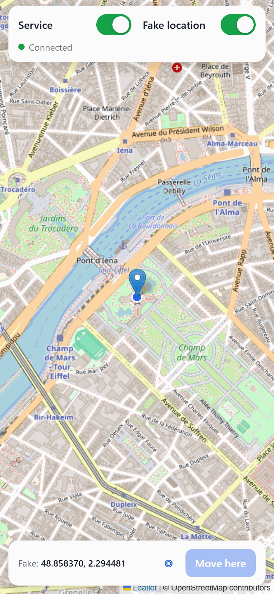

# iOS Location Server

**Self-hosted location spoofing for iPhone, over Wi-Fi.**

Fake your iPhone's GPS location from your own server: no jailbreak, no cable, no desktop app. A small
Docker container holds a simulated location on the phone, and you control it from a PWA on the phone
itself: drag a pin on a map, and toggle the service and the fake location on and off.

<p align="center">
  
</p>

- **Wi-Fi only, no root.** The container runs non-root, with all capabilities dropped and a read-only
  filesystem. It needs no host networking, `NET_ADMIN` or `/dev/net/tun`.
- **Survives locking and reboots.** It reconnects when the phone wakes up and remounts the developer disk
  image after a reboot.
- **Failswitch.** It turns itself off after 60 minutes without a connection (configurable).
- **Optional Live Activity.** It can mirror its status ("Connected", "Searching…") onto the lock screen
  through Home Assistant, either your existing instance or a throwaway one.

> Tested with an iPhone 11 on iOS 18.5, pymobiledevice3 11.27.2, and an Ubuntu server running Docker. It
> needs iOS 17.4 or newer. Other setups may work but are untested.

## How it works

The service is built on [pymobiledevice3](https://github.com/doronz88/pymobiledevice3):

1. It connects to the phone's lockdown service over Wi-Fi, using a **pairing file** copied from a computer
   the phone already trusts.
2. It keeps the phone's **heartbeat** service alive, which iOS requires before it accepts a Wi-Fi
   developer tunnel (see [Why the heartbeat matters](#why-the-heartbeat-matters)).
3. It opens the iOS 17.4+ CoreDeviceProxy tunnel through pymobiledevice3's pure-Python **userspace
   network stack**, which is why no root or TUN device is needed.
4. It mounts the developer disk image if needed, then re-sends the location every 5 s over the DVT
   `LocationSimulation` service.

About 100 s after you lock the phone, it goes into deep sleep. It sends `SleepyTime` and ends the tunnel
itself, so **the simulated location doesn't survive deep sleep**. The service retries, and reconnects
within a few seconds of the phone waking up.

If the phone stays unreachable for 60 minutes (`IDLE_TIMEOUT_MINUTES`), the service switches itself off.
It then stops retrying, ends the Live Activity and sends nothing more until you switch it back on in the
PWA.

## Requirements

- An iPhone with **iOS 17.4+** and **Developer Mode** enabled.
- A computer for a **one-time USB pairing**: Windows with the Apple Devices app, macOS, or Linux with
  `usbmuxd`.
- A Linux server with Docker on the **same local network** as the phone. The phone must be on your home
  Wi-Fi for this to work at all.
- An **HTTPS reverse proxy** if you want the PWA's location features. Browsers only allow location access
  in a secure context.

## Setup

### 1. Developer Mode

On the phone: Settings → Privacy & Security → Developer Mode. If the switch isn't shown yet, plug the phone
into your computer and run:

```bash
pip install pymobiledevice3
pymobiledevice3 amfi reveal-developer-mode
```

### 2. Pair once over USB and copy the pairing file

Plug the phone in, unlock it, and tap **Trust**. The pairing file is named after the phone's UDID:

| Computer | Location |
|---|---|
| Windows | `C:\ProgramData\Apple\Lockdown\<UDID>.plist` |
| macOS | `/var/db/lockdown/<UDID>.plist` (needs `sudo`) |
| Linux (usbmuxd) | `/var/lib/lockdown/<UDID>.plist` |

Copy it into the project folder as `pair_record.plist`. The container runs as UID 1000, so:

```bash
sudo chown 1000 pair_record.plist && chmod 600 pair_record.plist
```

> **The pairing file is a key to your phone.** Anyone holding it can use developer services on the phone
> while on the same network. Treat it like an SSH private key.

### 3. Allow Wi-Fi connections

Still on USB, from the pairing computer:

```bash
pymobiledevice3 lockdown wifi-connections on
```

### 4. Give the phone a fixed IP

- In your router, add a DHCP reservation for the phone.
- On the phone: Settings → Wi-Fi → (i) next to your network → **Private Wi-Fi Address → Fixed**. iOS 18's
  "Rotating" option changes the MAC address and breaks the reservation.

### 5. Configure and start

```bash
cp .env.example .env && chmod 600 .env   # set PHONE_IP
docker compose up -d --build
docker logs -f ios-location
```

The web UI listens on `127.0.0.1:8000` only.

### 6. HTTPS and the PWA

The service has **no login**. Don't expose it to the internet: anyone who reaches it can move your
phone's location. Put a reverse proxy with HTTPS in front and restrict it to your LAN.

Example for Traefik v3. In `docker-compose.yml`, replace `ports:` with a shared network and labels:

```yaml
    networks: [proxy]
    labels:
      - "traefik.enable=true"
      - "traefik.http.routers.ios-location.rule=Host(`location.example.com`)"
      - "traefik.http.routers.ios-location.entrypoints=websecure"
      - "traefik.http.routers.ios-location.tls.certresolver=myresolver"
      - "traefik.http.routers.ios-location.middlewares=ios-location-lan"
      - "traefik.http.middlewares.ios-location-lan.ipallowlist.sourcerange=192.168.1.0/24"
      - "traefik.http.services.ios-location.loadbalancer.server.port=8000"

networks:
  proxy:
    external: true
```

The allowlist checks the TCP source address, not `X-Forwarded-For`. If you also route public traffic
through an upstream proxy or VPN, make sure that hop's address isn't in the allowed range.

Then open the URL in Safari on the phone → Share → **Add to Home Screen**, and allow location access.

## Optional: Live Activity via Home Assistant

The service can push its status into an iOS Live Activity through the Home Assistant Companion app. You
can use the Home Assistant you already run, or start a separate, throwaway one.

Requirements: Home Assistant Core **2026.7+**, Companion app **2026.9+** with notifications allowed, and
iOS 17.2+.

### Option A: your existing Home Assistant

No extra container needed. The service only calls Home Assistant's notify API.

1. Make sure the phone's Companion app is logged in to that Home Assistant.
2. Create a long-lived access token: Profile → Security → Long-lived access tokens. A token carries all of
   its user's rights and can't be limited to notifications, so consider a dedicated user for it.
3. [Find the notify service name](#finding-the-notify-service).
4. Set these in `.env`, then run `docker compose up -d`:
   - `HA_URL`: the address of your Home Assistant **as seen from the container**, e.g.
     `http://192.168.1.10:8123` or `https://ha.example.com`. `localhost` won't work, because inside the
     container it means the container itself.
   - `HA_TOKEN`: the token from step 2.
   - `HA_NOTIFY`: the notify service name, without `notify.`.

### Option B: a separate, throwaway Home Assistant

`docker-compose.ha.yml` starts its own Home Assistant (pinned to 2026.10.1), so nothing touches your
production instance. Removing the project removes it too.

1. Start both containers:
   ```bash
   docker compose -f docker-compose.yml -f docker-compose.ha.yml up -d --build
   ```
2. Open `http://<server>:8124`, create the owner account, then log in to that instance from the Companion
   app on the phone.
3. Create a long-lived access token: Profile → Security → Long-lived access tokens.
4. [Find the notify service name](#finding-the-notify-service).
5. Set `HA_TOKEN` and `HA_NOTIFY` in `.env` (`HA_URL` is set by `docker-compose.ha.yml`), then run the
   command from step 1 again.

### Finding the notify service

In Home Assistant: Settings → Developer tools → Actions, then search for `notify.mobile_app_`. The entry
for your phone, e.g. `notify.mobile_app_my_iphone`, gives you `HA_NOTIFY=mobile_app_my_iphone`.

The name follows the phone's name in the Companion app. If you rename the phone or log in again, update
`HA_NOTIFY`.

## Using it

- **Service toggle:** starts or stops the connection. Off releases the phone completely.
- **Fake location toggle:** switches between the simulated location and the real one while staying
  connected.
- **Map:** tap or drag the pin, then press **Move here**. The blue dot is the position the phone reports,
  so with the fake location on it should sit on the pin.
- **Failswitch:** after `IDLE_TIMEOUT_MINUTES` without a connection, the service turns itself off. Switch it
  back on in the PWA.

## Troubleshooting

| Log line | Meaning |
|---|---|
| `heartbeat: phone is going to sleep, reconnecting` | Normal. The phone went into deep sleep. |
| `heartbeat lost: TimeoutError()` / `session ended: TimeoutError()` while the phone is locked | Normal. A sleeping phone isn't reachable, and the service keeps retrying. |
| The same lines while the phone is **unlocked and on Wi-Fi** | Check `PHONE_IP` first. If that's correct, the phone's heartbeat service can get stuck; a phone reboot fixed it in testing. |
| `Home Assistant notify failed: 400 …` | `HA_NOTIFY` doesn't match an existing notify service (see the Live Activity section). |
| `Home Assistant notify failed: 401 …` | `HA_TOKEN` is invalid. |
| A notification arrives, but no Live Activity | Home Assistant or the Companion app is too old, or iOS ran out of its Live Activity start budget after a lot of toggling. The budget resets on its own within minutes to hours. |

## Resource use

About 85 MB of RAM. CPU is about 7% of one core while connected, because the userspace network stack
wakes up often, and close to zero when switched off.

## Removing it

```bash
docker compose -f docker-compose.yml -f docker-compose.ha.yml down -v --rmi local
```

Then delete the folder, remove the Home Assistant server from the Companion app, and, if you want a full
reset, clear the trusted computers on the phone (Settings → General → Transfer or Reset iPhone → Reset →
Reset Location & Privacy) and turn Developer Mode off.

## Caveats

- **Pinned dependency.** The Wi-Fi userspace tunnel works by replacing one private function in
  pymobiledevice3, so the version is pinned (`Dockerfile`). Check `app.py` (marked with a `ponytail:`
  comment) before upgrading.
- **iOS updates can break it.** Apple changes the developer protocols between releases.
- **One phone per instance.**
- **Third-party requests.** The PWA loads Leaflet from unpkg (with integrity hashes) and map tiles from
  OpenStreetMap.
- **Games.** Spoofing your location in games such as Pokémon GO violates their terms of service and can
  get your account banned. Was not tested.

## Why the heartbeat matters

The phone's heartbeat service (`com.apple.mobile.heartbeat`) sends `Marco` about every 10 s and expects
`Polo` back. iOS only accepts a Wi-Fi developer tunnel from a host that keeps this exchange running, and
drops an existing tunnel as soon as it stops. I haven't found this documented anywhere.

On Windows, Apple's own background service (Apple Mobile Device Service) keeps a heartbeat running for the
pairing it holds. Tools running on the same PC, or anything using a copy of the same pairing file, work
without sending a heartbeat of their own, until that PC shuts down. Then the phone drops the tunnel and
refuses new ones until some host with that pairing heartbeats again. That's why this service runs its own
heartbeat.

## Testing

`test_app.py` checks, without a phone, that a hanging connection times out, retries, and trips the
failswitch:

```bash
pip install pymobiledevice3==11.27.2 && python test_app.py
```

## License

[GPL-3.0-or-later](LICENSE), the same as pymobiledevice3, which this project builds on.

Not affiliated with or endorsed by Apple. iPhone and iOS are trademarks of Apple Inc.
